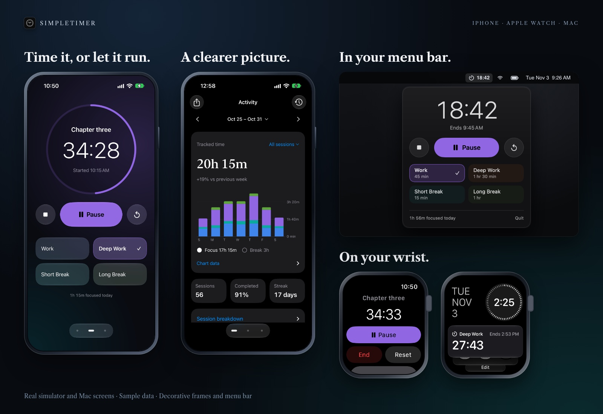

# SimpleTimer

A time tracker and focus app for iPhone, built to understand how you work. Optional Pomodoro sessions, an Apple Watch companion, and data export for AI analysis.

Pick a session. Start when you're ready. Nothing starts automatically.



[View full-size screens](docs/GALLERY.md) · Simulator screens with sample data.

## What it does

- Custom sessions, colours and durations.
- Swipe between Activity, Timer and Settings, or tap the page dots.
- System, Light and Dark appearance options.
- One large Start and Pause button. End and Reset sit beside it while a session runs. Reset stops the timer, restores its full duration and discards the current attempt. Saved history stays intact.
- Switching sessions mid-timer asks first, so a stray tap never ends your focus.
- When a session completes, one tap starts a suggested break, or your last focus session after a break. Nothing starts on its own.
- Stopwatch mode for untimed sessions. Tap the stopwatch in the corner, pick a session type, add an optional name and start. It counts up, works from the Watch and Lock Screen, and stops itself after 12 hours.
- Pause, resume, end or reset from the app or a Live Activity. Optionally keep the screen on while a timer runs.
- Activity charts and searchable history. Paused time doesn't count.
- A report you can attach to ChatGPT, Claude or another AI app.
- JSON history backup and import. Import skips duplicates.
- Apple Watch controls for the timer on your iPhone.

No account, analytics, ads, server or API key. Your history stays on your phone until you choose to export it.

## Build

You need a Mac, Xcode 26 or newer with iOS and watchOS platform support, and [XcodeGen](https://github.com/yonaskolb/XcodeGen).
The app supports iOS 17+ and watchOS 10+. Liquid Glass appears on iOS 26+.

```sh
cp Config/Local.xcconfig.example Config/Local.xcconfig
xcodegen generate
open SimpleTimer.xcodeproj
```

For your own device, put your Apple team ID and a unique bundle ID in `Config/Local.xcconfig`. This file is ignored by Git. Select your iPhone in Xcode and run. Keep the same bundle ID when updating an existing install to keep its data.

A free Apple account requires renewing the app's signing every seven days. Paired devices can install over the same Wi-Fi network. Don't delete the app to renew it.

```sh
./scripts/test-core.sh
./scripts/build-simulator.sh
./scripts/install-iphone.sh YOUR_DEVICE_ID
```

## Export to AI

Open **Activity → Share** or **Settings → Export & backup**. Choose a range, preview the report, then share or save the Markdown file and attach it in your AI app. Session names are hidden by default. Dates and durations are included. Nothing is uploaded in the background.

Use **Save history backup** for a complete JSON copy of finished sessions. Import adds missing sessions; it does not change your current timer or settings. Keep backups private.

## Apple Watch

The Watch runs the timer itself and syncs with your iPhone. Start, pause, resume, end, reset, switch modes or choose a session, and the change shows at once, even when the iPhone is out of reach. The two devices catch up whenever they can talk: the newest change wins, sessions saved on either device end up in one history, and a session already ended on one device never starts again on the other. "Syncs with iPhone later" appears only while the Watch has changes the phone has not received.

Sessions use the same colours as iPhone. A checkmark marks your current choice without dimming its name or duration.

Add the SimpleTimer widget to a watch face or the Smart Stack. It shows your current session live: a countdown or a running stopwatch beside a small timer mark, with the session name and when it ends. Tap it to open the app.

Build the `SimpleTimerWatch` scheme for a paired watch simulator or device. The watch app is also embedded in the iPhone build. See [validation](docs/VALIDATION.md) for tested behaviour and limits.

## Mac menu bar

A small Mac app for macOS 14+ that lives in the menu bar, with no Dock icon. Click its timer icon for a drop-down with the iPhone controls: one large Start and Pause button, End and Reset while a session runs, session types, and a stopwatch with an optional name. Space starts or pauses, and Esc closes it. Right-click a session type to change its length, or the icon for Launch at Login and Quit.

While a session runs, the menu bar shows the time beside the icon. Timed sessions notify you when they finish. The Mac keeps its own timer and history in `~/Library/Application Support/SimpleTimer`. It doesn't sync with your iPhone, and it has no history screen or export.

It works with menu bar managers such as Ice, Thaw and Bartender. If its icon is hidden, open SimpleTimer again from Spotlight or Finder to show the drop-down. [See the drop-down](docs/release-images/mac-panel.png).

```sh
./scripts/build-mac.sh
open DerivedData/Build/Products/Debug/SimpleTimer.app
```

To keep it, build the `SimpleTimerMac` scheme in Xcode with your team in `Config/Local.xcconfig`, then move `SimpleTimer.app` to Applications.

## How it's built

- `Core`: timer state, history, statistics, export and backup. Tested with Swift Package Manager.
- `App`: SwiftUI iPhone screens and local notifications.
- `LiveActivity` / `Shared`: Lock Screen controls and shared activity types.
- `Connectivity` / `WatchApp`: WatchConnectivity remote and watch interface.
- `Mac`: menu bar app, a SwiftUI drop-down in an AppKit panel.

See [architecture](docs/ARCHITECTURE.md) and [privacy](PRIVACY.md). MIT licensed.
