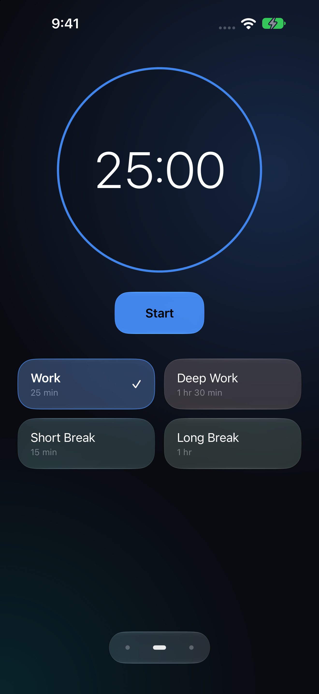
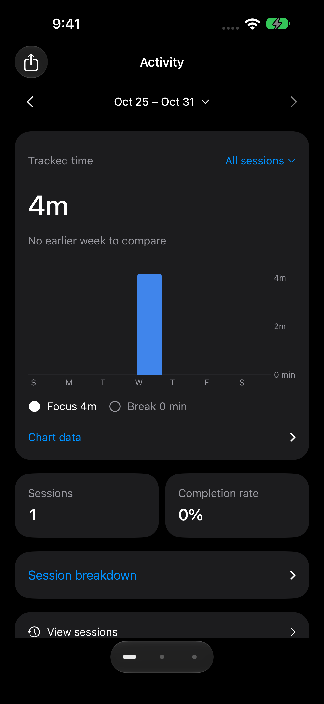
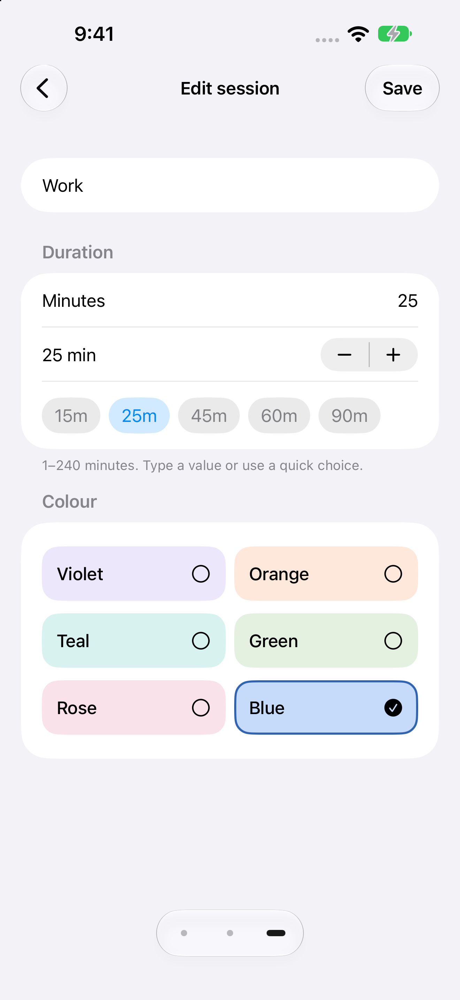
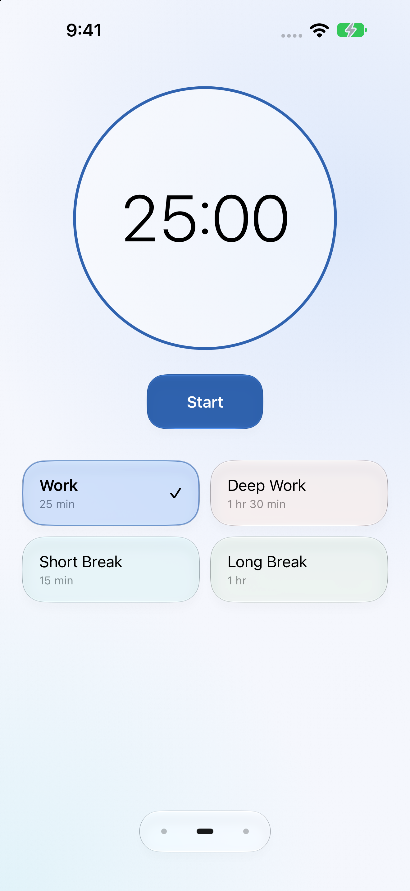
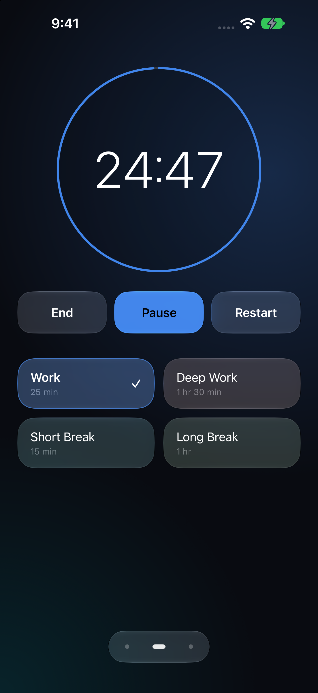
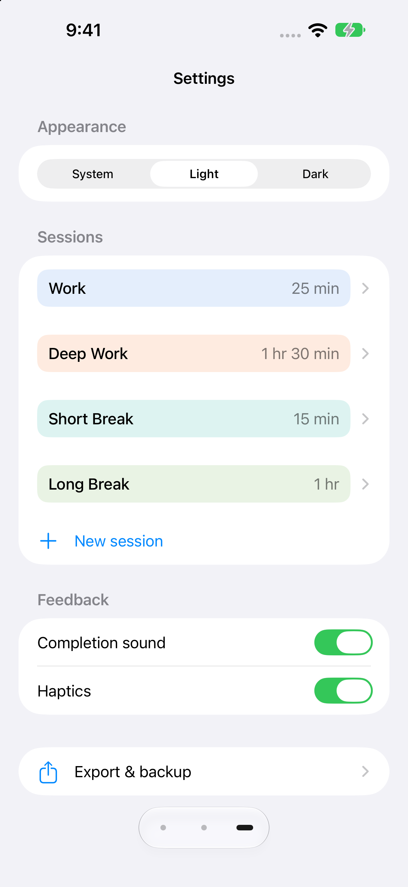
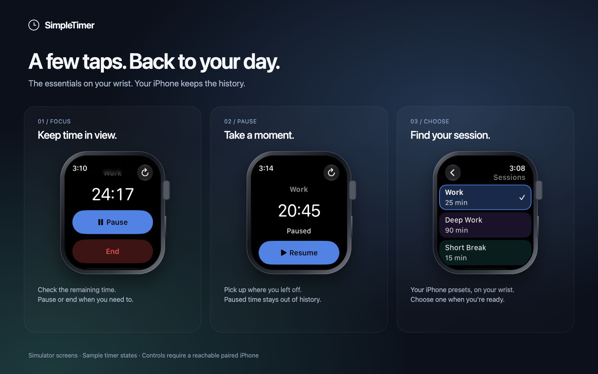

# SimpleTimer gallery

Real app screens captured in simulators with sample data. The frames are decorative. No personal device screens or history are shown.

## iPhone

Start a session, review your activity, or adjust the app. Swipe between the three pages or tap the dots.

<table>
  <tr><th>Timer</th><th>Activity</th><th>Session settings</th></tr>
  <tr>
    <td></td>
    <td></td>
    <td></td>
  </tr>
  <tr><th>Light appearance</th><th>Running timer</th><th>Settings</th></tr>
  <tr>
    <td></td>
    <td></td>
    <td></td>
  </tr>
</table>

## Apple Watch

Start, pause, resume or end your iPhone timer from your wrist. Scroll to reach more controls and your session list. Your iPhone saves the history; Watch commands need a reachable paired iPhone.

Open an original screenshot: [Ready](release-images/watch-ready.png) · [Running](release-images/watch-running.png) · [Paused](release-images/watch-paused.png) · [Sessions](release-images/watch-sessions.png).

## Updating the gallery

The [cover](gallery/overview.html), [Watch layout](gallery/watch.html) and [shared styles](gallery/gallery.css) use the original screenshots without redrawing the app interface. The canvases are 1600 × 1000 pixels. Serve this repository locally, open either layout in a browser, and capture the full page to update the matching JPG in `release-images`.

Use simulators and sample state for new captures. Keep private device captures, timer backups, signing files and device identifiers out of this folder.
