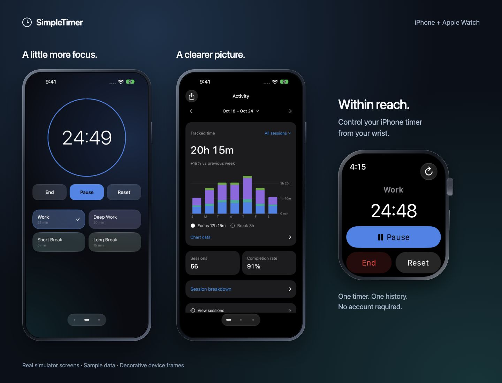

# SimpleTimer gallery

One view of the experience: focus on iPhone, review your activity, and control the timer from Apple Watch.

Open a full-resolution screen: [Timer](release-images/dashboard-running.png) · [Activity](release-images/activity.png) · [Apple Watch](release-images/watch.png).

These are real app screens from paired simulators. The Activity example uses 100 synthetic sessions across two weeks. The featured complete week contains 56 sessions, 20h 15m tracked and 91% completion. The device frames are decorative; no personal device screens or history are used.

## Updating the gallery

The [layout](gallery/overview.html) and [styles](gallery/gallery.css) place the original screenshots without redrawing the interface. Serve this repository locally, open the layout at a 1440 × 1100 viewport and capture it to `release-images/overview.jpg`.

Capture current controls, use a populated complete week for Activity, and check every image at full size. Strip image metadata before publishing. Keep private captures, timer backups, signing files and device identifiers out of this folder.
