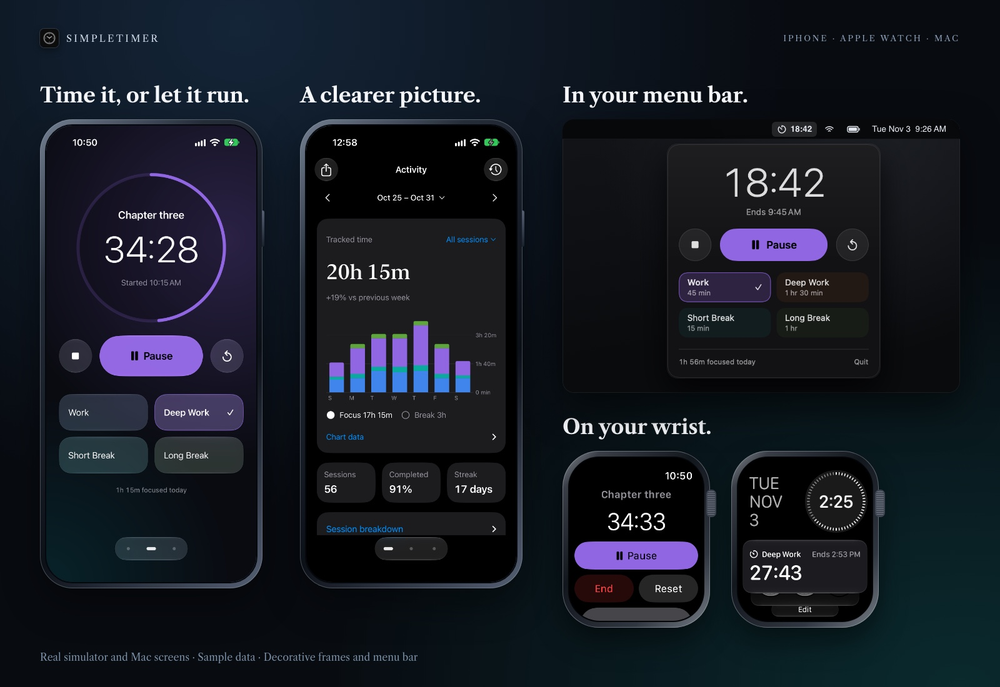

# SimpleTimer gallery

One view of the experience: focus on iPhone, review your activity, and control the timer from Apple Watch or the Lock Screen.

Open a full-resolution screen: [Timer](release-images/dashboard-running.png) · [Activity](release-images/activity.png) · [Apple Watch](release-images/watch.png) · [Live Activity](release-images/live-activity.png).

These are real app screens from paired simulators in dark mode. The Activity example uses 110 synthetic sessions: two complete weeks plus the two days before capture, which keeps the streak going. The featured complete week contains 56 sessions, 20h 15m tracked, 91% completed and a 17 day streak. The Live Activity is shown paused because the simulator hides running seconds on the Lock Screen. The device frames are decorative; no personal device screens or history are used.

## Updating the gallery

The [layout](gallery/overview.html) and [styles](gallery/gallery.css) place the original screenshots without redrawing the interface. Headlines use Instrument Serif and other text uses Inter, both loaded from Google Fonts, and the header uses the app icon, so capture with network access. Serve this repository locally, open the layout at a 1440 × 1100 viewport and capture it to `release-images/overview.jpg`.

Capture current controls, use a populated complete week for Activity, and check every image at full size. Strip image metadata before publishing. Keep private captures, timer backups, signing files and device identifiers out of this folder.
